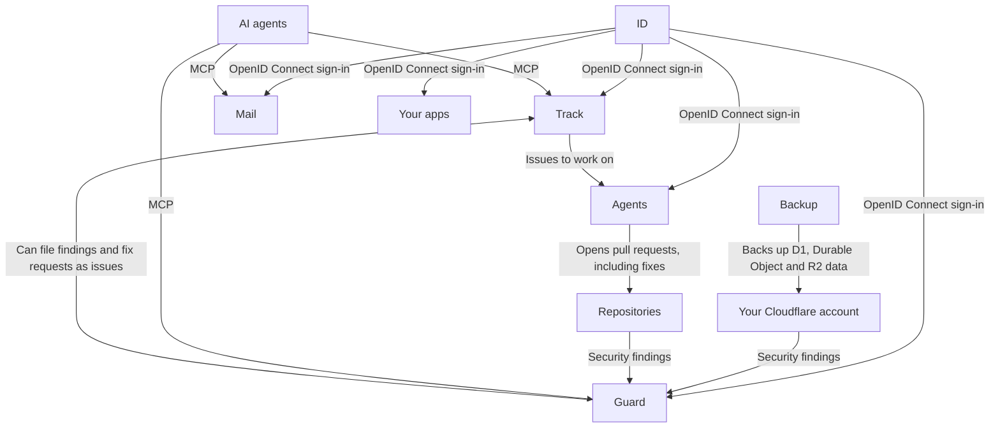

import { Card, CardGrid } from "@astrojs/starlight/components";
import AgentPrompt from "../../components/AgentPrompt.astro";
import products from "../../generated/sources.json";

export function product(key) {
	const found = products.find((product) => product.key === key);
	if (!found) throw new Error(`The sync does not know ${key}`);
	return found;
}

export function versioned(key) {
	const found = product(key);
	return `${found.summary} ${found.version === "main" ? "Not released yet." : `Version ${found.version}.`}`;
}

## Products

{/* The anchor elements stay on their own lines: the link validator does not see inline JSX. */}
<CardGrid>
	<Card title={product("track").name}>
		
{versioned("track")}

		<ul>
			<li>
				<a href="/track/">Overview</a>
			</li>
			<li>
				<a href="/track/#getting-started">Get started</a>
			</li>
			<li>
				<a href="/track/self-hosting/">Self-host</a>
			</li>
			<li>
				<a href="/track/#connect-an-ai-agent">MCP</a>
			</li>
		</ul>
	</Card>
	<Card title={product("agents").name}>
		
{versioned("agents")}

		<ul>
			<li>
				<a href="/agents/">Overview</a>
			</li>
			<li>
				<a href="/agents/#getting-started">Get started</a>
			</li>
			<li>
				<a href="/agents/self-hosting/">Self-host</a>
			</li>
		</ul>
	</Card>
	<Card title={product("id").name}>
		
{versioned("id")}

		<ul>
			<li>
				<a href="/id/">Overview</a>
			</li>
			<li>
				<a href="/id/#running-it-locally">Get started</a>
			</li>
			<li>
				<a href="/id/self-hosting/">Self-host</a>
			</li>
		</ul>
	</Card>
	<Card title={product("mail").name}>
		
{versioned("mail")}

		<ul>
			<li>
				<a href="/mail/">Overview</a>
			</li>
			<li>
				<a href="/mail/#getting-started">Get started</a>
			</li>
			<li>
				<a href="/mail/self-hosting/">Self-host</a>
			</li>
			<li>
				<a href="/mail/#connect-an-agent">MCP</a>
			</li>
		</ul>
	</Card>
	<Card title={product("guard").name}>
		
{versioned("guard")}

		<ul>
			<li>
				<a href="/guard/">Overview</a>
			</li>
			<li>
				<a href="/guard/self-hosting/#deploy-with-the-button">Get started</a>
			</li>
			<li>
				<a href="/guard/self-hosting/">Self-host</a>
			</li>
			<li>
				<a href="/guard/self-hosting/#connect-an-ai-assistant">MCP</a>
			</li>
		</ul>
	</Card>
	<Card title={product("backup").name}>
		
{versioned("backup")}

		<ul>
			<li>
				<a href="/backup/">Overview</a>
			</li>
			<li>
				<a href="/backup/#quick-start">Get started</a>
			</li>
			<li>
				<a href="/backup/deploy/">Self-host</a>
			</li>
		</ul>
	</Card>
</CardGrid>

## How the products fit together

See where your apps, repositories and Cloudflare account connect to the Gateweave products.

- ID signs people in to Track, Agents, Mail, Guard and your own apps over OpenID Connect.
- Guard reads your Cloudflare account and your repositories' lockfiles. It can file a finding as a
  Track issue, and a dependency finding can ask Agents for a fix through Track.
- Agents works from Track issues and opens pull requests in your repositories.
- AI agents connect to Track, Mail and Guard over MCP.
- Backup copies your Cloudflare account's D1, Durable Object and R2 data.

## Where these pages come from

Each product's pages are its own `README.md`, `docs/` and `CHANGELOG.md`, copied from [its
repository](https://github.com/gateweavehq) at its latest release every day. Every page links to
the file it came from, so a fix goes to the product's repository as a pull request.

## For AI agents

<AgentPrompt />

See [Agent setup](/agent-setup/) for a short workflow to choose the right docs and connect product
tools. Every product page has **View as Markdown**, **Copy as Markdown** and a page-specific
**Copy prompt** action.

The same pages as plain text, for a model's context:

- [`/llms.txt`](/llms.txt) lists what is here.
- [`/llms-full.txt`](/llms-full.txt) has every page, and [`/llms-small.txt`](/llms-small.txt) the same without changelogs and architecture notes.
- Each product's pages on their own are linked from `/llms.txt`.

An agent can also work in the products, not only read about them: Track, Mail and Guard have MCP
servers, and Agents' repository wikis answer an agent's questions over MCP. Their overviews say how
to connect one.
