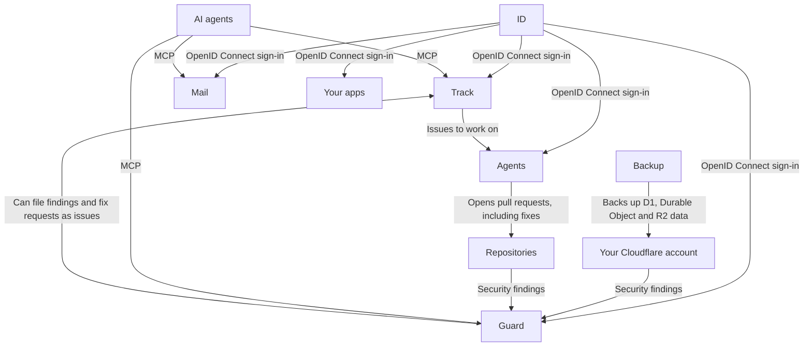

import { Card, CardGrid } from "@astrojs/starlight/components";
import AgentPrompt from "../../components/AgentPrompt.astro";
import products from "../../generated/sources.json";

export const paths = {
	track: {
		start: "/track/#getting-started",
		selfHost: "/track/self-hosting/",
		mcp: "/track/#connect-an-ai-agent",
	},
	agents: {
		start: "/agents/#getting-started",
		selfHost: "/agents/self-hosting/",
	},
	id: {
		start: "/id/#running-it-locally",
		selfHost: "/id/self-hosting/",
	},
	mail: {
		start: "/mail/#getting-started",
		selfHost: "/mail/self-hosting/",
		mcp: "/mail/#connect-an-agent",
	},
	guard: {
		start: "/guard/self-hosting/#deploy-with-the-button",
		selfHost: "/guard/self-hosting/",
		mcp: "/guard/self-hosting/#connect-an-ai-assistant",
	},
	backup: {
		start: "/backup/#quick-start",
		selfHost: "/backup/deploy/",
	},
};

## Products

<CardGrid>
	{products.map((product) => {
		const links = Object.hasOwn(paths, product.key) ? paths[product.key] : undefined;

		return (
			<Card title={product.name}>
				
{`${product.summary} ${product.version === "main" ? "Not released yet." : `Version ${product.version}.`}`}

				<ul>
					<li><a href={`/${product.key}/`}>Overview</a></li>
					{links?.start && <li><a href={links.start}>Get started</a></li>}
					{links?.selfHost && <li><a href={links.selfHost}>Self-host</a></li>}
					{links?.mcp && <li><a href={links.mcp}>MCP</a></li>}
				</ul>
			</Card>
		);
	})}
</CardGrid>

## How the products fit together

See where your apps, repositories and Cloudflare account connect to the Gateweave products.

- ID signs people in to Track, Agents, Mail, Guard and your own apps over OpenID Connect.
- Guard reads your Cloudflare account and your repositories' lockfiles. It can file a finding as a
  Track issue, and a dependency finding can ask Agents for a fix through Track.
- Agents works from Track issues and opens pull requests in your repositories.
- AI agents connect to Track, Mail and Guard over MCP.
- Backup copies your Cloudflare account's D1, Durable Object and R2 data.

## Where these pages come from

Each product's pages are its own `README.md`, `docs/` and `CHANGELOG.md`, copied from [its
repository](https://github.com/gateweavehq) at its latest release every day. Every page links to
the file it came from, so a fix goes to the product's repository as a pull request.

## For AI agents

<AgentPrompt />

See [Agent setup](/agent-setup/) for a short workflow to choose the right docs and connect product
tools. Every product page has **View as Markdown**, **Copy as Markdown** and a page-specific
**Copy prompt** action.

The same pages as plain text, for a model's context:

- [`/llms.txt`](/llms.txt) lists what is here.
- [`/llms-full.txt`](/llms-full.txt) has every page, and [`/llms-small.txt`](/llms-small.txt) the same without changelogs and architecture notes.
- Each product's pages on their own are linked from `/llms.txt`.

An agent can also work in the products, not only read about them: Track, Mail and Guard have MCP
servers, and Agents' repository wikis answer an agent's questions over MCP. Their overviews say how
to connect one.
